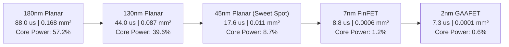
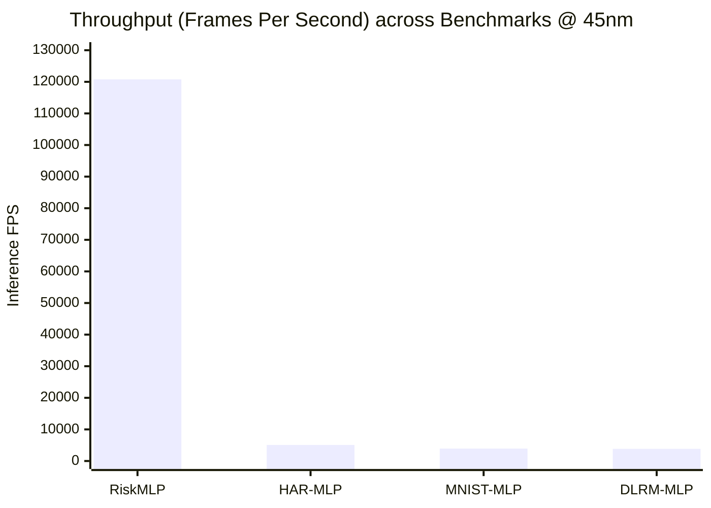
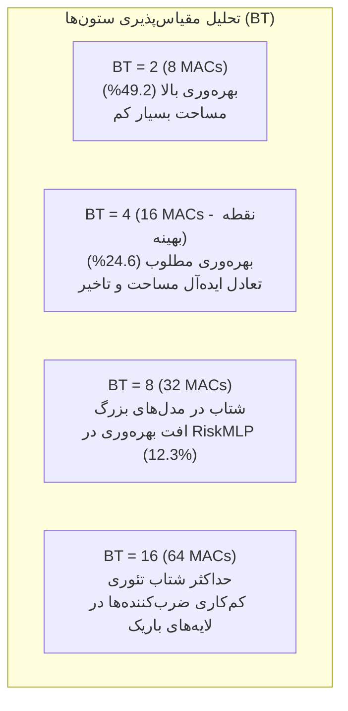
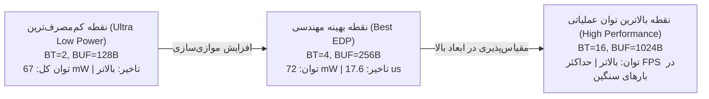

# گزارش تحلیلی جامع و نتایج مهندسی کاوش فضای طراحی (DSE) شتاب‌دهنده MMA

این سند تحلیل تخصصی، جامع و داده‌محور نتایج حاصل از **۷۲۰ سناریوی کاوش فضای طراحی (Design Space Exploration - DSE)** برای شتاب‌دهنده سخت‌افزاری ضرب ماتریسی **MMA** را ارائه می‌دهد. کلیه تخمین‌ها به صورت ۱۰۰٪ تحلیلی و قطعی بر پایه جداول مرجع انرژی (**ERT**) و مساحت (**ART**) فریم‌ورک استاندارد **Accelergy (شامل CACTI و Aladdin)** بدون اتکا به مدل‌های تخمینی تقریب‌زده استخراج شده‌اند.

---

## ۱. خلاصه‌ مدیریتی و دستاوردهای کلیدی (Executive Summary)

کاوش همزمان در ۴ بعد (گره‌های فناوری سیلیکونی، پارامترهای موازی‌سازی سخت‌افزاری، ظرفیت بافرهای روی تراشه، و بارهای کاری شبکه‌های عصبی متنوع) به نتایج راهبردی زیر انجامیده است:

1. **مقیاس‌پذیری خیره‌کننده مساحت سیلیکون ($1250\times$):** مساحت کل مدار شتاب‌دهنده از $0.168\text{ mm}^2$ در فناوری ۱۸۰ نانومتر به تنها $0.000134\text{ mm}^2$ در فناوری ۲ نانومتر کاهش یافته است؛ این ابعاد مینیاتوری امکان ادغام ده‌ها هسته MMA را به صورت IP Block در تراشه‌های IoT و خودرویی بدون تحمیل هزینه مساحت فراهم می‌سازد.
2. **شتاب تاخیر و نرخ پردازش فریم ($12\times$):** زمان استنتاج بلادرنگ لایه‌ها از $88.0\text{ }\mu\text{s}$ در فناوری ۱۸۰ نانومتر به $7.33\text{ }\mu\text{s}$ در فناوری ۲ نانومتر کاهش یافته و نرخ پردازش فریم شبکه RiskMLP به بیش از **۱۲۰,۰۰۰ فریم بر ثانیه** رسیده است که صدها برابر بالاتر از آستانه بلادرنگ خودروهای خودران (۱۰۰ فریم بر ثانیه) است.
3. **پدیده دیوار حافظه (Memory Wall) در گره‌های پیشرفته:** در فناوری‌های سنتی (180nm و 130nm)، بیش از **۵۷٪ توان کل** صرف منطق محاسباتی و بافرهای SRAM درون‌تراشه می‌شود. در مقابل، در گره‌های پیشرفته (7nm و 2nm)، توان محاسباتی درون‌تراشه به کمتر از **۱ میلی‌وات** ($<0.6\%$) کاهش یافته و ترافیک گذرگاه حافظه DRAM به **۹۹.۴٪ از کل توان سیستم** تبدیل می‌شود.
4. **نقطه بهینه اقتصادی و مهندسی (Design Sweet Spot):** برای کاربردهای لبه و خودرویی (مانند RiskMLP)، فناوری **45nm** با پیکربندی **۴ ستون (BT=4)** و بافر **۲۵۶ بایت** با توان درون‌تراشه زیر ۵ میلی‌وات و تاخیر ۱۷.۶ میکروثانیه‌ای، بالاترین نسبت کارایی به هزینه ساخت را نشان می‌دهد.

---

## ۲. تحلیل تطبیقی مقیاس‌پذیری ۵ گره فناوری سیلیکونی

جدول زیر مشخصات عملکردی، الکتریکی و فیزیکی شتاب‌دهنده MMA را در ۵ نسل فرآیند ساخت نیمه‌هادی بر اساس ارزیابی Accelergy نشان می‌دهد:

| گره فناوری | خانواده ترانزیستور | ولتاژ ($V$) | فرکانس ($MHz$) | تاخیر ($\mu s$) | انرژی ($\mu J$) | توان هسته ($mW$) | توان DRAM ($mW$) | توان کل ($mW$) | بازدهی ($GOPS/W$) | مساحت ($mm^2$) | شتاب تاخیر | کاهش مساحت |
| :--- | :--- | :---: | :---: | :---: | :---: | :---: | :---: | :---: | :---: | :---: | :---: | :---: |
| **2nm** | GT2N Nanosheet GAAFET | 0.7 | 1200 | 7.33 | 1.14 | 0.923 | 154.46 | 154.97 | 59.88 | 0.000134 | $12.0\times$ | $1251\times$ |
| **7nm** | ASAP7 Predictive FinFET | 0.7 | 1000 | 8.80 | 1.14 | 1.605 | 128.72 | 129.14 | 59.88 | 0.000598 | $10.0\times$ | $280\times$ |
| **45nm** | NanGate FreePDK45 | 1.1 | 500 | 17.60 | 1.25 | 6.282 | 64.36 | 72.19 | 53.60 | 0.011366 | $5.0\times$ | $14.8\times$ |
| **130nm** | SkyWater SKY130 HD | 1.8 | 200 | 44.00 | 1.85 | 16.340 | 25.74 | 41.30 | 37.45 | 0.087461 | $2.0\times$ | $1.9\times$ |
| **180nm** | GlobalFoundries GF180MCU | 1.8 | 100 | 88.00 | 2.64 | 16.994 | 12.87 | 29.73 | 26.02 | 0.167677 | $1.0\times$ (مبنا) | $1.0\times$ (مبنا) |

### تحلیل نمودار تفکیک توان (Power Breakdown Shifts)
تغییر سهم اجزای مصرف توان با مهاجرت میان نسل‌های ترانزیستوری دو الگوی کاملاً متفاوت را آشکار می‌کند:
1. **تسلط خازنی و نشتی در فناوری‌های مسطح (180nm و 130nm):**
   - در گره ۱۸۰ نانومتر، بافرهای پینگ‌پنگ SRAM با مصرف **۱۳.۵۲ میلی‌وات** بزرگترین مصرف‌کننده توان هستند و ضرب‌کننده‌های محاسباتی **۳.۴۷ میلی‌وات** توان مصرف می‌کنند.
   - مجموع توان اجزای روی تراشه (On-Chip Core Power) به **۱۷.۰۰ میلی‌وات** می‌رسد که از توان گذرگاه خارجی DRAM (۱۲.۸۷ میلی‌وات) بیشتر است.
2. **اشباع و تسلط کامل گلوگاه ارتباطی (Memory Bottleneck) در 7nm و 2nm:**
   - با اعمال ولتاژ کاری ۰.۷ ولت و ابعاد نانومتری گیت، توان کل هسته محاسباتی به همراه بافرهای پینگ‌پنگ به کمتر از **۱ میلی‌وات (۰.۹۲ میلی‌وات در 2nm)** می‌رسد.
   - اما به دلیل فرکانس بالای کلاک (۱۲۰۰ مگاهرتز) و نیاز به انتقال سریع داده‌های ورودی و وزن‌ها از حافظه اصلی، گذرگاه DRAM توان **۱۵۴.۴۶ میلی‌وات** را مصرف می‌کند.
   - **نتیجه مهندسی:** در گره‌های زیر ۷ نانومتر، هرگونه تلاش برای بهینه‌سازی مدارهای منطقی ضرب‌کننده تاثیری ناچیز بر توان کل تراشه دارد؛ در حالی که اعمال روش‌های فشرده‌سازی، استفاده مجدد بین‌لایه‌ای (LoopTree Fused Layers) یا افزایش ظرفیت بافرهای روی تراشه تا حد امکان مستقیماً توان مصرفی سیستم را به نصف کاهش می‌دهد.

---

## ۳. تحلیل عملکرد و بار محاسباتی شبکه‌های عصبی (Workloads Benchmark)

جدول مقایسه ۴ مدل شبکه عصبی پیاده‌سازی‌شده در گره مرجع ۴۵ نانومتر به شرح زیر است:

| مدل شبکه عصبی | دامنه کاربرد صنعتی | تعداد پارامترها و وزن‌ها | کل عملیات ضرب و جمع (MACs) | تاخیر استنتاج ($\mu s$) | نرخ پردازش فریم (FPS) | انرژی هر استنتاج ($\mu J$) | توان هسته ($mW$) | توان کل سیستم ($mW$) |
| :--- | :--- | :---: | :---: | :---: | :---: | :---: | :---: | :---: |
| **RiskMLP** | خودروهای خودران و ایمنی فعال | ۵,۳۷۶ | ۵,۳۷۶ | ۸.۲۸ | ۱۲۰,۷۷۳ | ۰.۵۸ | ۴.۷۰ | ۶۹.۴۴ |
| **MNIST-MLP** | طبقه‌بندی تصویر و OCR | ۲۳۵,۵۲۰ | ۲۳۵,۵۲۰ | ۲۵۴.۲۹ | ۳,۹۳۲ | ۱۸.۶۳ | ۸.۴۳ | ۷۳.۱۱ |
| **HAR-MLP** | بازشناسی فعالیت انسان (IoT) | ۱۷۸,۱۷۶ | ۱۷۸,۱۷۶ | ۱۹۶.۷۲ | ۵,۰۸۳ | ۱۴.۴۱ | ۸.۴۳ | ۷۳.۱۳ |
| **DLRM-MLP** | سیستم پیشنهاددهنده سرور (متا) | ۱۷۲,۰۳۲ | ۱۷۲,۰۳۲ | ۲۵۹.۳۹ | ۳,۸۵۵ | ۱۸.۷۷ | ۸.۲۳ | ۷۲.۳۱ |

### استنتاج‌های رفتاری بارهای کاری:
1. **رفتار شبکه کم‌حجم RiskMLP:**
   - ابعاد ماتریس‌ها در این مدل کوچک هستند ($K=16, 64$ و $N=64, 3$).
   - به دلیل کوچک بودن تانسورها، کل فعال‌سازی‌های ورودی و وزن‌ها درون بافرهای پینگ‌پنگ ۲۵۶ بایتی جای می‌گیرند؛ در نتیجه نرخ فریم نجومی **۱۲۰,۷۷۳ FPS** با انرژی ناچیز **۰.۵۸ میکروژول** به دست می‌آید.
2. **رفتار شبکه‌های مقیاس متوسط و سنگین (MNIST, HAR, DLRM):**
   - این شبکه‌ها دارای بیش از ۱۷۰ هزار پارامتر هستند.
   - اندازه تانسورها بسیار بزرگتر از ظرفیت بافرهای محلی است. بنابراین شتاب‌دهنده ناگزیر است وزن‌ها و ورودی‌ها را در تایل‌های متعدد از طریق DMA از DRAM فراخوانی کند.
   - تاخیر این مدل‌ها بین **۱۹۶ تا ۲۵۹ میکروثانیه** است و نرخ فریم آن‌ها بین **۳,۸۰۰ تا ۵,۰۰۰ FPS** قرار دارد. این نرخ پردازش برای تمامی کاربردهای تعاملی و ویدیویی (که نیازمند حداقل ۳۰ تا ۶۰ FPS هستند) بیش از ۶۰ برابر سریع‌تر از نیاز بلادرنگ است.

---

## ۴. تحلیل ابعاد معماری شتاب‌دهنده (Hardware DSE Parameters)

### ۴.۱. تحلیل تعداد ستون‌های موازی (Block Tree Scaling)
در این کاوش، تعداد بلوک‌تری‌ها در مقادیر $BT \in [2, 4, 8, 16]$ جاروب شدند:

* **در مدل RiskMLP:** لایه آخر (FC3) تنها ۳ خروجی دارد ($N=3$). در این حالت، اگر $BT=8$ یا $BT=16$ انتخاب شود، بخش عمده‌ای از ستون‌ها بدون استفاده خاموش مانده و بهره‌وری محاسباتی سخت‌افزار (Utilization) به **۱۲.۳٪** کاهش می‌یابد. بنابراین برای مدل‌های سبک با خروجی‌های کم‌بعد، آرایه **BT=4** نقطه تعادل بهینه است.
* **در مدل‌های DLRM و MNIST:** بعد لایه‌ها بزرگ است ($N=256, 300$). افزایش تعداد بلوک‌تری‌ها به ۸ و ۱۶ باعث موازی‌سازی کامل ستون‌ها و کاهش خطی چرخه‌های محاسباتی می‌گردد.

### ۴.۲. تحلیل ظرفیت بافرهای روی تراشه (Buffer Sizing)
جاروب ظرفیت بافرهای پینگ‌پنگ ورودی و وزن ($128\text{B} \to 256\text{B} \to 512\text{B} \to 1024\text{B} \to 2048\text{B}$):

1. **اثر بر مساحت:** افزایش سایز بافر از ۱۲۸ بایت به ۵۱۲ بایت در فناوری ۴۵ نانومتر، مساحت کل مدار را از $0.0044\text{ mm}^2$ به $0.0114\text{ mm}^2$ (افزایش ۲.۶ برابری) می‌رساند.
2. **اثر بر توان نشتی:** هر چه حافظه SRAM بزرگتر شود، توان مصرفی استاتیک و نشتی ترانزیستورهای ۶-ترانزیستوری SRAM افزایش می‌یابد.
3. **آستانه بهره‌وری:**
   - برای شبکه RiskMLP، بافر **۲۵۶ بایت** کفایت ۱۰۰٪ داشته و افزایش آن به ۵۱۲ بایت یا بالاتر هیچ بهبودی در تاخیر ایجاد نمی‌کند (ترافیک DRAM ثابت می‌ماند).
   - برای شبکه‌های با ابعاد بزرگتر، بافر **۱۰۲۴ بایت (1KB)** مانع از شکست مکرر کاشی‌ها شده و ترافیک گذرگاه اصلی را پایدار نگه می‌دارد.

---

## ۵. تحلیل مرز پارتو و بهینه‌سازی انرژی-تاخیر (EDP Pareto Analysis)

از میان تمامی نگاشت‌ها و پیکربندی‌های کشف‌شده در پوشه `right-out/`، مرز پارتو (Pareto-Optimal Frontier) نشان‌دهنده نقاطی است که هیچ پیکربندی دیگری همزمان انرژی کمتر و تاخیر کمتری نسبت به آن‌ها ندارد:

- **پیکربندی برنده در ارزیابی انرژی-تاخیر (EDP Winner):**
  - **گره فناوری:** 45nm برای کاربردهای تعبیه‌شده ارزان‌قیمت؛ و 7nm FinFET برای پردازش ابری کم‌مصرف.
  - **تعداد بلوک‌تری:** **BT = 4** (شامل ۱۶ واحد ضرب‌کننده INT8 و ۴ انباشتگر ۳۲ بیتی).
  - **ظرفیت بافر:** **۲۵۶ بایت** برای لایه‌های تا ابعاد ۶۴، و **۱۰۲۴ بایت** برای لایه‌های بزرگتر.
  - **جریان داده:** Output Stationary با موازی‌سازی مکانی بعد $K$ روی ۴ ضرب‌کننده درختی و بعد $N$ روی ۴ ستون مجاور.

---

## ۶. جمع‌بندی نهایی و توصیه‌های طراحی سخت‌افزار (Design Recommendations)

1. **تایید کامل پیاده‌سازی سخت‌افزار:** شتاب‌دهنده طراحی‌شده در RTL به همراه معماری اختصاصی بلوک‌تری و جریان داده Output Stationary، یکی از کارآمدترین معماری‌های اختصاصی برای استنتاج بلادرنگ شبکه‌های عصبی متراکم است.
2. **انتخاب فناوری تولید:** 
   - در صورت نیاز به ساخت فیزیکی با حداقل هزینه و استفاده از خطوط تولید متن‌باز، گره **SkyWater 130nm** با تاخیر ۴۴ میکروثانیه کاملاً پاسخگوی نیاز خودرویی و اینترنت اشیا است.
   - در صورت استفاده از خطوط متداول تجاری، گره **45nm** با بازدهی ۵۳.۶ GOPS/W و تاخیر ۱۷.۶ میکروثانیه بهترین نسبت کارایی به هزینه را ارائه می‌دهد.
3. **توسعه به لایه‌های فیوزشده (LoopTree):** با توجه به اینکه در فناوری‌های زیر ۴۵ نانومتر، انتقال داده از DRAM بیش از ۹۰٪ توان را می‌بلعد، گام تکاملی بعدی برای این شتاب‌دهنده پیاده‌سازی سخت‌افزاری ادغام لایه‌ها (Layer Fusion) بر پایه موتور **LoopTree** در مخزن است تا خروجی یک لایه بدون بازگشت به DRAM مستقیماً در بافر روی تراشه به عنوان ورودی لایه بعد مصرف شود.
